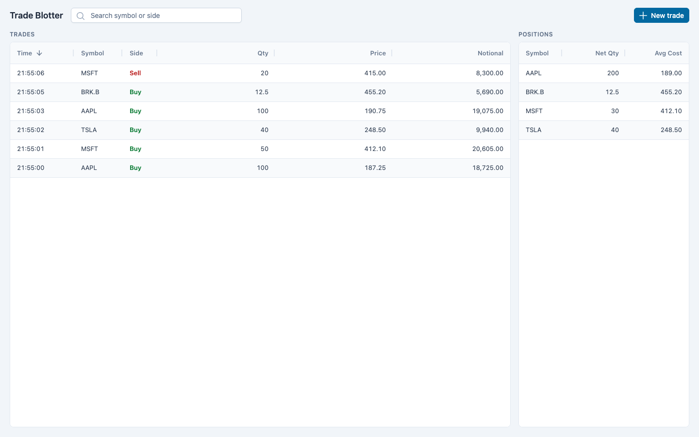

# Trade Blotter

Enter trades, see them in a sortable, searchable blotter, and see positions derived from trade history. .NET 8 Web API + SQLite, Vue 3 + Pinia + PrimeVue + AG Grid Community.



## Run locally

Prerequisites: .NET 8 SDK and Node 24. `global.json` pins `8.0.x`; if `dotnet --version` shows another major version, put .NET 8 first: `export DOTNET_ROOT=$HOME/.dotnet PATH=$HOME/.dotnet:$PATH`.

```sh
# terminal 1: API on http://localhost:5080 (Swagger at /swagger); creates the SQLite DB on first run
cd backend && dotnet run --project src/TradeBlotter.Api

# terminal 2: app on http://localhost:5173 (proxies /trades and /positions to 5080)
cd frontend && npm install && npm run dev
```

Tests: `cd backend && dotnet test`, `cd frontend && npm test`, and `cd frontend && npx playwright install chromium && npm run e2e` for the full-stack suite.

## API

| Endpoint | Success | Errors |
|---|---|---|
| `POST /trades` `{symbol, side, quantity, price}` | `201` + `Location`, the created trade | `400` ValidationProblemDetails, `415` non-JSON |
| `GET /trades` | `200`, all trades, newest first | |
| `GET /trades/{id}` | `200` | `404` |
| `GET /positions` | `200`, `{symbol, netQuantity, averageCost}` by symbol, zero positions omitted | |

Unexpected failures return `500` ProblemDetails without exception detail. Contract: `docs/openapi.json`, examples in `docs/examples/`.

## Assumptions and design decisions

- **Money is `decimal`, not `double`.** Exact arithmetic means a closed position nets to exactly zero, so "omit zero positions" needs no epsilon. Quantity and price must be > 0, at most 1,000,000,000, with at most 4 decimal places; fractional shares are allowed.
- **Average-cost method.** Per symbol, in trade order: adding to a position re-weights the average; reducing it keeps the average; closing to zero drops it; crossing zero (long to short or back) opens the new position at that trade's price. Shorts are negative net quantities. The calculator is a pure function (`Features/Positions/PositionCalculator.cs`) covered by the design's worked examples and mutation-tested. `averageCost` is rounded to 6 decimal places in the response so it survives JavaScript number parsing.
- **Positions are derived on every request**, never stored. At this scale an in-memory fold over all trades is simpler than maintaining a positions table and can't drift from the trade history.
- **The server owns time.** `POST /trades` takes no timestamp; the server stamps UTC on insert (a client-sent `timestamp` is ignored). The browser shows times in its local timezone. Equal timestamps are ordered by an internal insertion sequence.
- **Symbols** are trimmed and upper-cased; 1–10 characters of `A-Z 0-9 . -` (e.g. `BRK.B`).
- **Side is Buy or Sell only.** Short selling is a Sell that takes the position negative; no separate short/cover types.
- **No users or auth.** Out of scope per the exercise; there is no per-user data.
- **No pagination.** `GET /trades` returns everything and the grid sorts and filters client-side. Server-side paging with client-side sort/filter raises consistency questions between fetches that this scope doesn't need.
- **Refresh after submit, not push.** After a successful POST, the Pinia stores re-fetch trades and positions from the server, which keeps the server the single source of truth (no optimistic merge, no ordering races).
- **Trade entry is a modal** behind a "New trade" button in the toolbar, so the blotter and positions keep the full page. The form validates the same rules as the server and maps server errors back onto fields.
- **AG Grid Community only.** Side colouring is a custom cell renderer; search is an external filter on symbol and side. Multi-cell paste is Enterprise-only, so bulk entry was dropped.
- **PrimeVue 4** (MIT). PrimeVue 5 shows a license badge without a registered key.

## What's next

- Live updates across clients (SSE or SignalR) instead of refresh-after-own-submit.
- Server-side paging with a `since` cursor once trade volume makes returning everything slow.
- Realised and unrealised P&L, which needs market prices.
- Authentication and per-user books.
- Bulk entry (CSV upload or a paste parser), amend/cancel of trades with an audit trail.
- A CI workflow running tests, lint, e2e and mutation testing on pull requests.

## Development

### Claude Code MCP servers and skills

- `.mcp.json` registers three project MCP servers, run through `npx`: AG Grid (`ag-mcp`), PrimeVue (`@primevue/mcp`) and Playwright (`@playwright/mcp`). Claude Code asks you to approve them on first use.
- `.claude/skills/` holds the vendors' official skills, copied from [`ag-grid/skills`](https://github.com/ag-grid/skills) (`ag-dev`, `ag-update`) and [`primefaces/primeui-plugins`](https://github.com/primefaces/primeui-plugins/tree/main/plugins/primevue/skills) (`primevue-*`; these call the PrimeVue MCP tools). To update them, re-copy from those repos.

### Backend notes

SQLite via EF Core 8. There are no migrations: the schema is created from the model on startup with `EnsureCreated`, which does nothing if the database already exists. After changing the model, delete the `.db` file so the next start recreates it. The database file defaults to `src/TradeBlotter.Api/trade-blotter.db` (gitignored); override it with `ConnectionStrings__TradeBlotter="Data Source=/path/to/file.db"`.

Backend behavior worth knowing:

- Validation lives in `Features/Trades/TradeValidator`, run per property by `[TradeRules]`, so every invalid field is reported in one 400 with the same ValidationProblemDetails shape. `side` binds as a string and is validated with the other fields; OpenAPI still documents it as the `Side` enum. Error keys are the camelCase JSON field names (`symbol`, `side`, `quantity`, `price`), set in `Http/ValidationProblemFactory` (HTTP plumbing shared by controllers) from MVC's JSON naming policy.
- Money must be a JSON number. `"quantity": "100"` is a 400, not coerced.
- SQLite stores decimals as TEXT and reads `100` back as `100.0`, so responses may carry a trailing `.0`. The value is identical.
- 500s are ProblemDetails with no exception detail outside Development.

Mutation score (Stryker.NET 4.16.0, `Features/**`, 2026-10-20): **97.92%**, 47 killed, 1 survived, 0 timeouts. 13 mutants did not compile and 4 were skipped as already covered; neither counts.

| File | Killed | Survived |
|---|---|---|
| `Positions/PositionCalculator.cs` | 22 | 1 |
| `Positions/PositionService.cs` | 1 | 0 |
| `Trades/TradeService.cs` | 5 | 0 |
| `Trades/TradeValidator.cs` | 19 | 0 |

Remaining survivor:

- `PositionCalculator`: `q <= held` → `q < held`. Equivalent. When a trade closes the position to exactly zero, the mutant keeps the trade price as the average instead of the old one, but a zero position is omitted and the next trade starts fresh because `held` is 0, so no output changes.

### Frontend notes

```sh
npm run dev:mock  # serve /trades and /positions from an in-memory mock (frontend/mock/), no backend
npm run build
```

- **Layout.** `src/App.vue` is a CSS grid: toolbar row, blotter, positions panel beside it (stacked below 900px). The PrimeVue Aura preset uses a sky-700 primary (white button text passes WCAG AA), Buy/Sell use green-700/red-700, and the AG Grid Quartz theme reads the same PrimeVue CSS variables (`src/theme.ts`). Dark mode is off.
- **Code map.** `src/api/` holds stateless fetch calls (ProblemDetails → `ApiError`). `src/stores/` holds the Pinia `trades` and `positions` stores; a successful create re-fetches both. `src/lib/` has pure helpers: formatting, search matching, and validation that mirrors the server. `src/components/` holds the views.
- **Blotter columns.** Time, Symbol and Side have fixed widths; Qty, Price and Notional share the rest with tabular digits. Time shows `HH:mm:ss` for today and `dd MMM HH:mm:ss` for older trades, with the full date on hover; sorting uses the raw timestamp.
- **Search** matches symbol or side as a case-insensitive substring, through an AG Grid external filter.
- **Mutation score** (Stryker.js on `src/**/*.ts` except components, tests and `main.ts`, 2026-10-20): **96.53%** (167 killed, 6 survived). `src/lib` 99.11%, `src/api` 94.44%, `src/stores` 88.00%. Survivors: an equivalent `value === null` guard in `tradeValidation.ts` (`Number.isFinite(null)` is already false); in `src/stores/resource.ts`, `++latest → --latest` (equivalent) and two stale-response guards with no test for an older failing request finishing after a newer one; in `src/api/http.ts`, the `ApiError` name and the fallback problem body.
- **Vitest is pinned to 4.1.12.** `@stryker-mutator/vitest-runner` filters tests by name in a way Vitest 5 doesn't match for tests nested in `describe`, so under Vitest 5 those tests never ran against mutants and the score was understated.

### API contract

- `docs/openapi.json`: the OpenAPI document exported from Swashbuckle. A backend test fails if it drifts from the running app; regenerate it with `UPDATE_OPENAPI=1 dotnet test backend`.
- `docs/examples/`: request, response and validation-error payloads. A backend test deserializes them into the DTOs.
- `frontend/src/api/types.ts`: TypeScript mirror of the contract.

### Tests

```sh
cd backend && dotnet test   # xUnit; fails below 80% line coverage (coverlet; Program.cs excluded)
cd frontend && npm test     # Vitest; fails below 80% lines/branches/functions/statements
```

### Lint, format and hooks

```sh
cd frontend && npx biome check .                        # Biome: format + lint TS/JS/Vue/JSON
dotnet tool restore && dotnet csharpier check backend   # CSharpier (local tool in .config/dotnet-tools.json)
lefthook install                                        # once per clone (also run by `npm install` in frontend)
```

- **pre-commit** (lefthook): Biome and CSharpier fix staged files, the file-length check warns, then `dotnet test` runs if `backend/**` is staged and `npm test` if `frontend/**` is staged.
- **Claude Code** (`.claude/settings.json`): after every Edit/Write/MultiEdit, `scripts/claude-post-edit.sh` formats and lints the file (including root-level `*.json`) and runs the file-length check. It requires `jq`. Lint errors exit 2 so the agent sees them.
- **pre-push** (lefthook): knip (unused files, exports and dependencies in `frontend/`, config `frontend/knip.jsonc`) and jscpd (duplication across `backend/` and `frontend/src`, fails above 3%, config `.jscpd.json`).
- `scripts/check-file-length.sh [files]` warns about files over 500 lines and never fails; with no arguments it checks every tracked file.
- Run the dev tools directly with `npm run lint`, `npm run knip` and `npm run dup` in `frontend/`.
- `scripts/dotnet-env.sh` puts `~/.dotnet` first on PATH, since git hooks don't read shell profiles. `scripts/with-dotnet.sh` (hooks) and `scripts/mutation-backend.sh` source it.

### Mutation testing

On demand only, never on a hook. Thresholds: high 80, low 60, break 50.

```sh
scripts/mutation-backend.sh               # Stryker.NET on backend Features/** (local tool, `dotnet tool restore`)
scripts/mutation-backend.sh --since:main  # only mutants in files changed since main
cd frontend && npm run mutation           # Stryker.js on src/**/*.ts (no components), incremental
```

Both use cores − 1 for concurrency. Reports land in `backend/StrykerOutput/` and `frontend/reports/mutation/` (gitignored).

### End-to-end tests

Playwright drives the real stack: the .NET API on 5080 and Vite on 5173 through its proxy (not the mock).

```sh
cd frontend
npx playwright install chromium   # once
npm run e2e                       # e2e/blotter.spec.ts; report in frontend/playwright-report/
npm run e2e:screenshots           # e2e/screenshots.spec.ts; rewrites docs/screenshots/e2e-*.png
```

- `playwright.config.ts` starts both servers through `webServer` and fails if its ports (5080 and 5173 by default) are already in use, so a stale server or database is never reused. The backend gets a new SQLite file in the OS temp directory on every run, through `ConnectionStrings__TradeBlotter`.
- To run beside a dev server, pick other ports: `E2E_API_PORT=5180 E2E_WEB_PORT=5183 npm run e2e`. The config passes the API port to Vite as `API_PORT`, which sets the proxy target (default 5080).
- A failing test keeps a trace and a screenshot in `frontend/test-results/<run timestamp>/`. Each run gets its own directory, so a rerun does not delete the last failure; open it with `npx playwright show-trace <path>/trace.zip`.
- The backend needs the .NET 8 SDK; the config runs it through `scripts/with-dotnet.sh`.
- The tests run in declaration order on one worker and share that database. Each test uses its own symbols, and the first one checks the empty state.
- The browser runs at 1440×900 with locale `en-US` and timezone `America/New_York`, so formatted numbers and times are deterministic.

## How this was built

Built with Claude Code. A coordinator session wrote the design (`docs/superpowers/specs/`) and per-agent briefs (`docs/briefs/`), then ran agents in parallel in separate git worktrees through herdr (a terminal multiplexer for coding agents): Part 1 skeleton, Part 2 backend and frontend side by side, Part 3 e2e/UI and backend polish side by side, then review fixes. Read-only review subagents audited the result against the exercise, the design and the architecture. Full transcripts are in [`transcripts/`](transcripts/).
